# Composer 與 AoV 管理系統使用流程

本文件說明兩個系統各自的使用流程，以及兩者之間如何銜接。流程圖使用 Mermaid 語法，可在 GitHub、VS Code（Markdown Preview Mermaid 外掛）或 Typora 直接顯示。

內容依 2026-11-11 工作樹（分支 `feature/start-script-case-store`）的原始碼與 `docs/` 整理。每張圖後面標明依據的檔案；「尚未提供」的項目如實列出，不當成已完成。

## 1. 名詞與定位

| 名詞 | 意義 | 主要依據 |
|---|---|---|
| AoV | 以流程節點、連線、表單與關聯描述一套業務流程的規格；Composer 以它作為設定入口 | `docs/project-spec.md` 4.2 |
| Composer | 設定端工具。使用者在畫面上畫流程、設定細項與參數，輸出給發行端使用的設定交付包 | `apps/composer-gui/src/StepShell.tsx` |
| AoV 管理系統 | 管理流程規格本身的一組功能：畫布編輯、Kit 範例庫、專案檔轉換、案例庫（版本史、淘汰與合併節點） | `docs/aov-standalone-canvas.md`、`docs/aov-case-store.md` |
| 獨立 AoV 畫布 | 同一個 Vite 專案的第二個入口（`aov-canvas.html`），只含畫布、匯入匯出、範例庫、節點細項與專案檔下載 | `docs/aov-standalone-canvas.md` 第 4 節 |
| 案例庫 | 使用者自己保存的流程版本史，每個版本記修改原因與作者，版本存入後不可修改 | `docs/aov-case-store.md` |
| 範例庫 | 隨產品提供的唯讀參考流程，內容由各 Kit 的 `workflow.aov.json` 轉換而來 | `docs/aov-standalone-canvas.md` 第 2 節 |
| 設定交付包 | Composer 輸出的 zip；是設定，不是可安裝系統 | `docs/project-spec.md` 第 12 節 |

### 1.1 系統組成與啟動

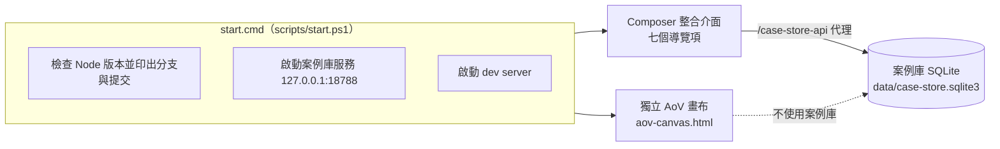

- 案例庫服務需要 Node 22.13 以上；Node 較低時啟動腳本提示並略過，案例庫頁面會顯示「服務尚未啟動」。
- 獨立畫布不連案例庫，狀態只存在目前頁面，重新整理即清空。

## 2. Composer 使用流程

### 2.1 導覽結構

左側導覽共七項（`AppShell.tsx`）：

| 導覽項 | 狀態 |
|---|---|
| 首頁 | 顯示本次工作階段的設定概況（工廠、節點、表單、關聯、已啟用功能數） |
| 流程 | 五個必經步驟，見 2.2 |
| 案例庫 | 見第 3 節 |
| 發布準備 | 見 2.4 |
| 資料集 | 骨架頁，列出規劃內容，標示「尚未提供」 |
| 執行記錄 | 骨架頁，目前只做設定期，無執行期 |
| 系統設定 | 骨架頁（Migration、相容性），標示「尚未提供」 |

### 2.2 「流程」頁的五個步驟

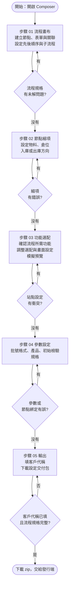

說明：

- 五個步驟都必經；每一步有錯誤訊息時會擋住該步驟的確認（`App.tsx` 的 `stepError`），錯誤要在該步驟內修正。
- 步驟 01 的畫布可從「範例庫」載入 Kit 流程當起點，也可匯入流程規格檔。
- 步驟 03 的功能由流程節點推導：節點對應動作，動作需要哪個 Kit 就自動勾選並標示原因；有多個候選 Kit 時請使用者擇一；仍有缺口時畫面提示交由維護人員確認。推導由程式依固定規則判斷，不交給 LLM。
- 步驟 05 的輸出頁可個別下載流程規格與系統設定檔（收在「進階」），用於重新載入設定。

### 2.3 步驟 01 流程畫布內的操作

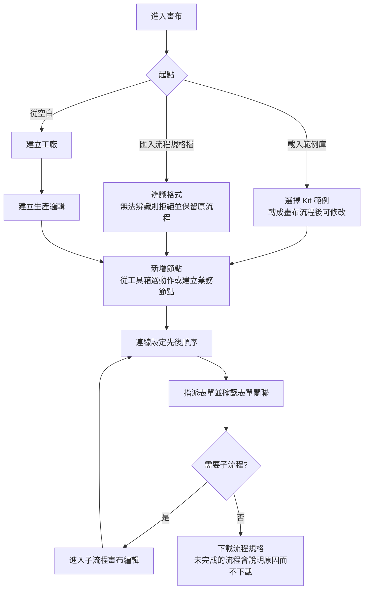

要點：

- 工具箱會依案例庫現況，將「已淘汰」或「已合併」的動作停用並標示原因；既有節點不動；案例庫服務連不上時維持原狀（D181）。
- 表單關聯首期只支援共用識別欄位；系統提出候選，使用者確認後才生效，未確認的關聯不輸出（D19）。
- 匯入格式辨識：`composer-aov-list`、`composer-kit-workflow`、專案檔（`formatVersion` 1），其他格式拒絕（D187、D188）。

### 2.4 發布準備

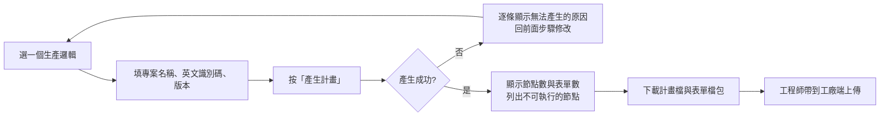

- 計畫檔產生後內容不再改變；同一份流程與設定每次產生的結果相同，要修改須回前面步驟並提高版本。
- 領料、入庫、出庫目前沒有對應的系統功能，計畫會把這些節點標為不可執行。
- 這裡不會連線到工廠。

### 2.5 Composer 到交付的完整鏈

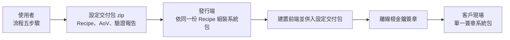

- Composer 輸出頁下載的設定交付包不可單獨安裝；可安裝的系統包由發行端在組裝與簽章後產生（`docs/project-spec.md` 第 12 節，D149、D150）。
- 系統包的已知限制（沒有 TLS、沒有升級遷移等）以 `docs/project-spec.md` 第 12 節為準，不對客戶宣稱已具備。

## 3. AoV 管理系統使用流程

### 3.1 功能總覽

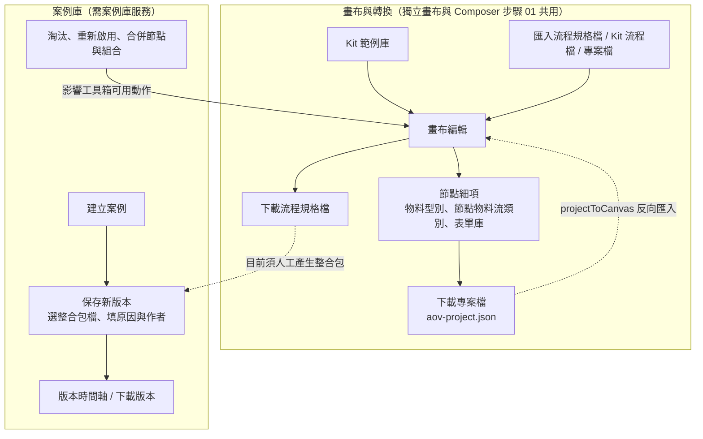

注意：畫布目前**不能**直接把流程存成案例庫版本，因為從畫布產生整合包的轉換尚未提供（D181）；保存新版本時需自行選擇既有的整合包 JSON 檔。

### 3.2 獨立 AoV 畫布流程

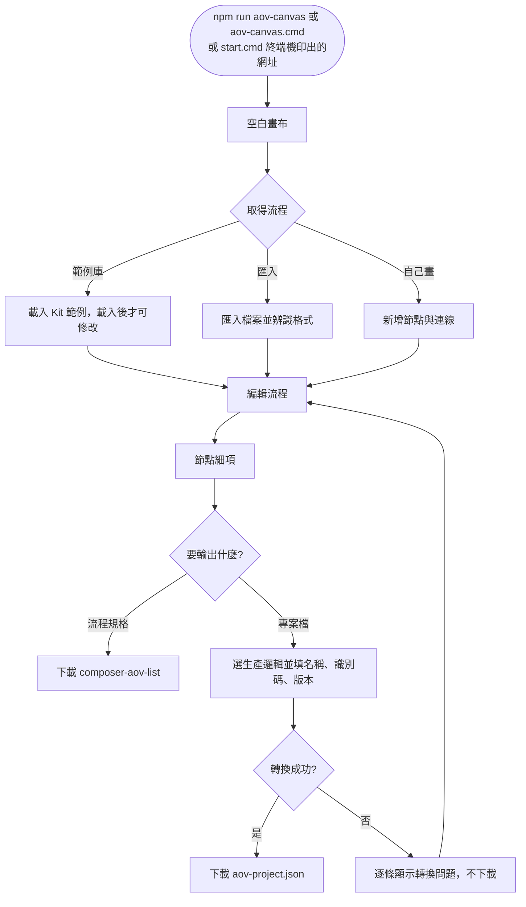

限制：重新整理頁面會清空流程、表單與節點細項；範例庫只顯示 Kit 自標的狀態，不宣稱已驗證（D185）。

### 3.3 案例庫：保存版本

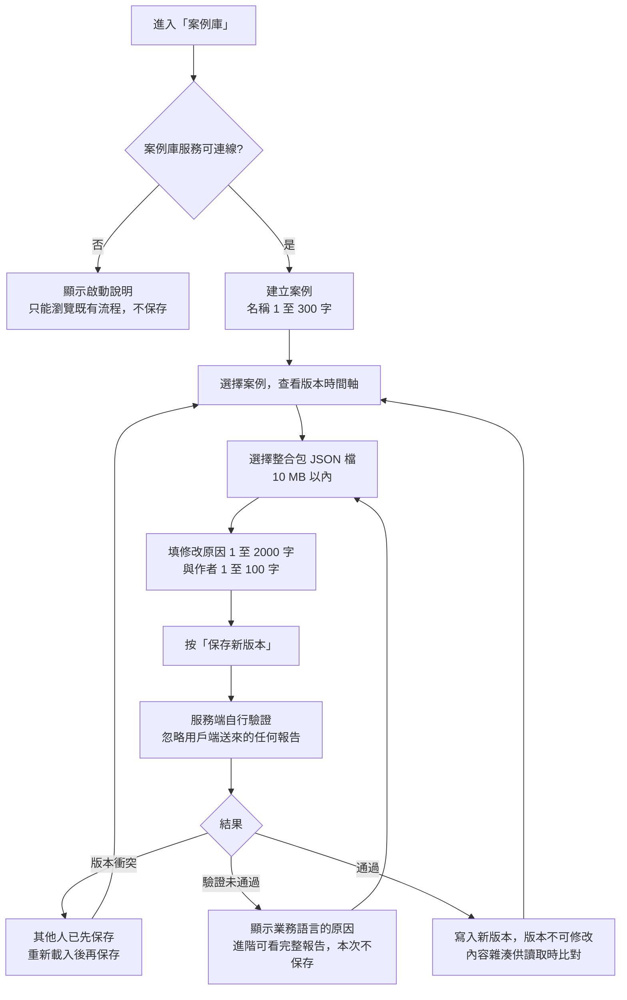

- 驗證範圍是整合包契約加 A core 的 `compile`；瀏覽器內互動模擬與正式執行環境未重跑，報告以 `scope`、`notRun` 如實標明（D180）。
- 作者為自填，無法驗證身分。
- 第 1 版修改原因可寫「初版」；其餘版本必填。

### 3.4 案例庫：節點與組合的生命週期

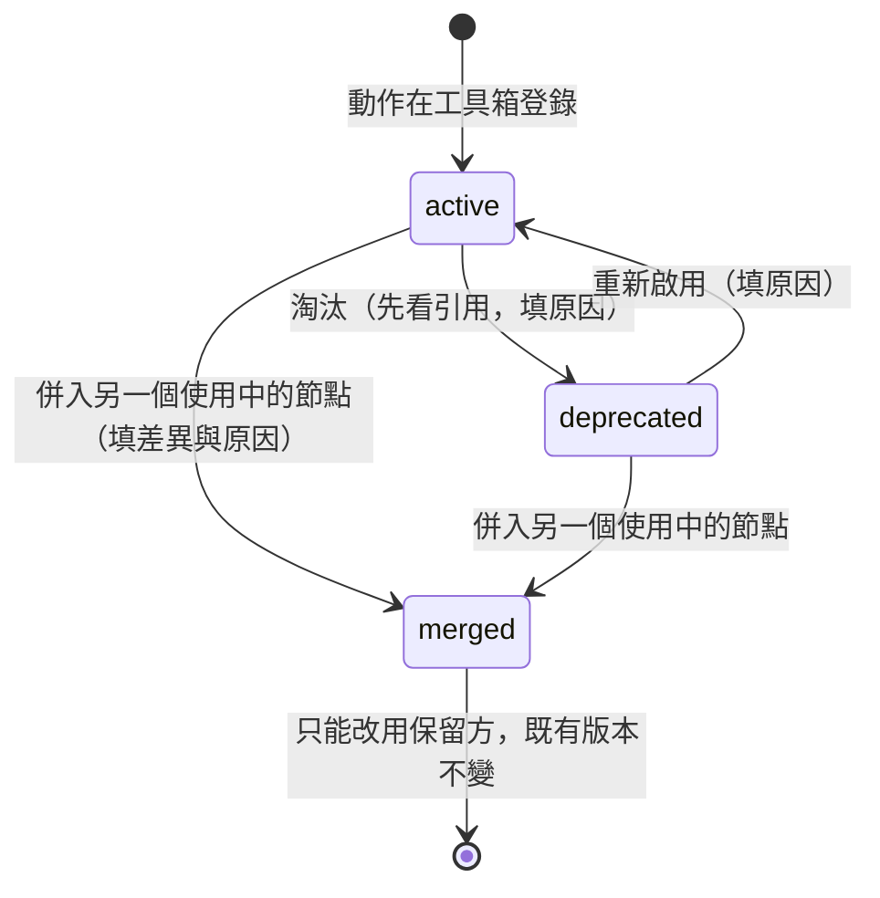

淘汰節點的操作流程：

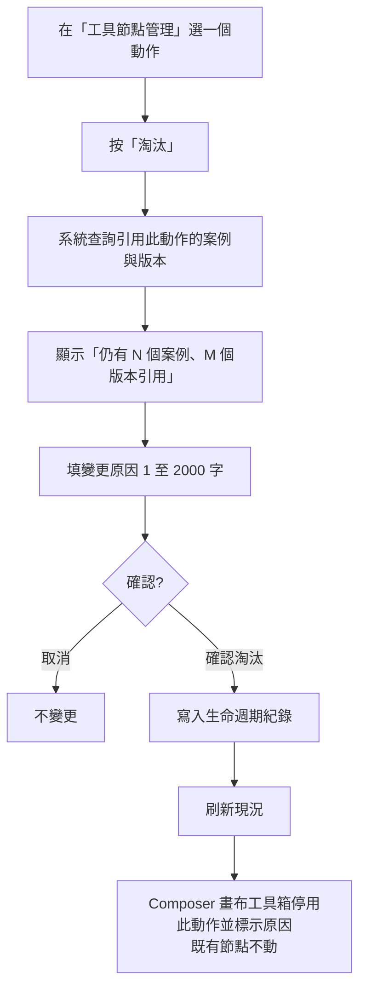

組合管理：依序加入至少兩個直接相連的節點，可淘汰或重新啟用整個組合（只比對同一張圖內直接相連的節點，中間隔了其他節點不算命中）。合併節點時，保留方必須為使用中；已合併者不能再被當作合併來源或保留方。

## 4. 兩個系統如何銜接

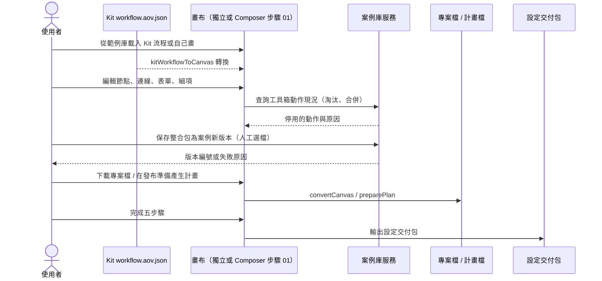

## 5. 尚未提供或未驗證的項目

| 項目 | 現況 |
|---|---|
| 從畫布直接保存為案例庫版本 | 未提供（整合包的產生尚未做，D181） |
| 案例庫版本的變更原因分類與節點層級差異 | 設計中（D192），尚未實作 |
| 案例庫分離為獨立專案 | 暫停（D193） |
| 小模型協助補完 AoV | 在 `feature/aov-small-model` 分支進行中，未合併到 `main`，本文件不描述其流程 |
| 資料集、執行記錄、系統設定三個導覽項 | 骨架頁，標示「尚未提供」 |
| 執行期驅動 | 不在範圍，目前只做設定期（D16） |
| 瀏覽器互動模擬與正式執行環境的驗證 | 案例庫驗證不重跑 |
| 本文件本身 | 依原始碼與文件整理，Mermaid 圖尚未在渲染器中逐張檢視；尚未對照畫面逐步操作驗證 |

## 6. 來源索引

| 主題 | 檔案 |
|---|---|
| 導覽與頁面 | `apps/composer-gui/src/AppShell.tsx`、`App.tsx` |
| 五個步驟 | `apps/composer-gui/src/StepShell.tsx` |
| 功能選配 | `apps/composer-gui/src/FlowPage.tsx` |
| 發布準備 | `apps/composer-gui/src/PublishPrepPage.tsx`、`libs/aov-integration/publishPrep.ts` |
| 案例庫畫面 | `apps/composer-gui/src/CaseLibraryPage.tsx` |
| 案例庫資料契約 | `docs/aov-case-store.md` |
| 獨立畫布與範例庫 | `docs/aov-standalone-canvas.md` |
| 設定交付包與組裝 | `docs/project-spec.md` 第 12 節 |
| 決議 | `docs/decision-log.md`（D16 至 D30、D149、D150、D175 至 D193） |
