# analytical-four-kit 變更紀錄

本檔記錄這個 Kit 的作業流程（`workflow.aov.json`）每次修改了哪些節點、為什麼改、改前改後的畫布長什麼樣。
它由 `node scripts/kit-changelog.mjs` 產生，請不要手改；改了流程描述後執行 `add` 補一筆（見 `docs/kit-authoring.md`）。
測試會檢查：紀錄從空白依序重播後必須等於目前的流程描述，且本檔文字與機器可讀資料一致。

| 修改原因分類 | 意義 |
| --- | --- |
| initial | 初版：Kit 第一次建立流程描述 |
| new-feature | 新增功能：Kit 多了能力，流程跟著補節點 |
| align-runtime | 對齊實際行為：流程描述與實際程式行為不符，已修正 |
| wording | 用語調整：節點名稱改成更精確或更貼近業務的說法 |
| dependency | 前置關係：調整哪一步必須先完成哪一步 |
| granularity | 粒度調整：節點拆分、合併或移除重複 |
| verification-finding | 實測發現：在測試機實際操作後發現需要修改 |
| other | 其他：須在修改原因寫清楚 |

## #7　2026-11-06　new-feature

- 修改原因分類：新增功能：Kit 多了能力，流程跟著補節點
- 修改原因：新增案例庫回復舊版本：發布案例庫的節點多了回復能力，回復時發布成新版本而不改寫歷史（D184）
- Kit 版本：0.1.0　作者：yucheng384752　來源：git:8e03de1

### 被修改的節點

| 節點名稱（node_name） | node_id | 動作 | 變化 |
| --- | --- | --- | --- |
| 發布案例庫新版本，必要時回復舊版本 | publish-library | 修改 | 名稱：「發布案例庫新版本」改為「發布案例庫新版本，必要時回復舊版本」；增加能力：analytical-four.library.restore |

### 畫布：修改前

```mermaid
flowchart LR
  n_accept_upload["接受或丟棄上傳的檔案"]
  n_approve_feedback["核可回饋"]
  n_check_data["檢查資料檔與欄位對照"]
  n_check_ready["確認資料與設定就緒"]
  n_compile["彙整事件"]
  n_configure["調整分析設定"]
  n_descriptive["描述性分析"]
  n_diagnostic["診斷性分析"]
  n_get_templates["下載範本與需求表"]
  n_llm["AI 綜合診斷"]
  n_load_demo["載入示範資料"]
  n_ng_code["不良類型診斷"]
  n_publish_library["發布案例庫新版本"]:::edit
  n_rag["SOP 檢索"]
  n_read_data["讀取並整理資料"]
  n_search_key["擷取搜尋關鍵"]
  n_similarity["相似案例搜尋"]
  n_start_run["啟動分析"]
  n_submit_feedback["提交確認結果"]
  n_topology["製程位置對應"]
  n_upload_files["上傳資料與設定檔並看驗證報告"]
  n_view_results["取得分析結果"]
  n_view_run["查看執行狀態"]
  n_accept_upload --> n_check_data
  n_approve_feedback --> n_publish_library
  n_check_ready --> n_start_run
  n_compile --> n_search_key
  n_configure --> n_check_data
  n_configure --> n_check_ready
  n_descriptive --> n_diagnostic
  n_diagnostic --> n_ng_code
  n_get_templates --> n_configure
  n_get_templates --> n_upload_files
  n_ng_code --> n_topology
  n_rag --> n_compile
  n_read_data --> n_descriptive
  n_search_key --> n_similarity
  n_similarity --> n_llm
  n_start_run --> n_read_data
  n_start_run --> n_view_run
  n_submit_feedback --> n_approve_feedback
  n_topology --> n_rag
  n_upload_files --> n_accept_upload
  n_view_results --> n_submit_feedback
  n_view_run --> n_view_results
  classDef add fill:#d6f5dc,stroke:#2e7d32
  classDef remove fill:#fbd9d9,stroke:#c62828
  classDef edit fill:#fff3c4,stroke:#b58900
  classDef link fill:#dbe9ff,stroke:#1f5fbf
```

### 畫布：修改後

```mermaid
flowchart LR
  n_accept_upload["接受或丟棄上傳的檔案"]
  n_approve_feedback["核可回饋"]
  n_check_data["檢查資料檔與欄位對照"]
  n_check_ready["確認資料與設定就緒"]
  n_compile["彙整事件"]
  n_configure["調整分析設定"]
  n_descriptive["描述性分析"]
  n_diagnostic["診斷性分析"]
  n_get_templates["下載範本與需求表"]
  n_llm["AI 綜合診斷"]
  n_load_demo["載入示範資料"]
  n_ng_code["不良類型診斷"]
  n_publish_library["發布案例庫新版本，必要時回復舊版本"]:::edit
  n_rag["SOP 檢索"]
  n_read_data["讀取並整理資料"]
  n_search_key["擷取搜尋關鍵"]
  n_similarity["相似案例搜尋"]
  n_start_run["啟動分析"]
  n_submit_feedback["提交確認結果"]
  n_topology["製程位置對應"]
  n_upload_files["上傳資料與設定檔並看驗證報告"]
  n_view_results["取得分析結果"]
  n_view_run["查看執行狀態"]
  n_accept_upload --> n_check_data
  n_approve_feedback --> n_publish_library
  n_check_ready --> n_start_run
  n_compile --> n_search_key
  n_configure --> n_check_data
  n_configure --> n_check_ready
  n_descriptive --> n_diagnostic
  n_diagnostic --> n_ng_code
  n_get_templates --> n_configure
  n_get_templates --> n_upload_files
  n_ng_code --> n_topology
  n_rag --> n_compile
  n_read_data --> n_descriptive
  n_search_key --> n_similarity
  n_similarity --> n_llm
  n_start_run --> n_read_data
  n_start_run --> n_view_run
  n_submit_feedback --> n_approve_feedback
  n_topology --> n_rag
  n_upload_files --> n_accept_upload
  n_view_results --> n_submit_feedback
  n_view_run --> n_view_results
  classDef add fill:#d6f5dc,stroke:#2e7d32
  classDef remove fill:#fbd9d9,stroke:#c62828
  classDef edit fill:#fff3c4,stroke:#b58900
  classDef link fill:#dbe9ff,stroke:#1f5fbf
```

<details><summary>機器可讀資料</summary>

<!-- kit-changelog-entry -->
```json
{
  "seq": 7,
  "kitVersion": "0.1.0",
  "date": "2026-11-06",
  "author": "yucheng384752",
  "source": "git:8e03de1",
  "cause": "new-feature",
  "reason": "新增案例庫回復舊版本：發布案例庫的節點多了回復能力，回復時發布成新版本而不改寫歷史（D184）",
  "nodes": [
    {
      "op": "edit",
      "nodeId": "publish-library",
      "nodeName": "發布案例庫新版本，必要時回復舊版本",
      "fields": {
        "name": {
          "before": "發布案例庫新版本",
          "after": "發布案例庫新版本，必要時回復舊版本"
        },
        "capabilityIds": {
          "before": [
            "analytical-four.library.publish",
            "analytical-four.library.versions"
          ],
          "after": [
            "analytical-four.library.publish",
            "analytical-four.library.restore",
            "analytical-four.library.versions"
          ]
        }
      }
    }
  ],
  "edges": [],
  "beforeSha": "63e1a97b6e18ee77278acfdab220bce9fa1d8bf075f8d1edfa8f6646508ce7b6",
  "afterSha": "728004a7da44c859f97705189482eb100ea9a63d8ab4b69599e9410f45241066"
}
```

</details>

## #6　2026-11-06　align-runtime

- 修改原因分類：對齊實際行為：流程描述與實際程式行為不符，已修正
- 修改原因：流程描述改成與程式實際行為一致：執行是依序進行（錯誤代碼、拓撲、檢索），原本畫成診斷後平行展開再匯入編譯，與 runs.py 的階段順序不符（D183）
- Kit 版本：0.1.0　作者：yucheng384752　來源：git:7ecdd2f

### 被修改的節點

| 節點名稱（node_name） | node_id | 動作 | 變化 |
| --- | --- | --- | --- |
| 彙整事件 | compile | 連線變更 | 移除連線「不良類型診斷」→「彙整事件」；移除連線「製程位置對應」→「彙整事件」 |
| 診斷性分析 | diagnostic | 連線變更 | 移除連線「診斷性分析」→「SOP 檢索」；移除連線「診斷性分析」→「製程位置對應」 |
| 不良類型診斷 | ng-code | 連線變更 | 新增連線「不良類型診斷」→「製程位置對應」；移除連線「不良類型診斷」→「彙整事件」 |
| SOP 檢索 | rag | 連線變更 | 新增連線「製程位置對應」→「SOP 檢索」；移除連線「診斷性分析」→「SOP 檢索」 |
| 製程位置對應 | topology | 連線變更 | 新增連線「不良類型診斷」→「製程位置對應」；新增連線「製程位置對應」→「SOP 檢索」；移除連線「診斷性分析」→「製程位置對應」；移除連線「製程位置對應」→「彙整事件」 |

### 連線變更

- 新增連線：「不良類型診斷」→「製程位置對應」
- 新增連線：「製程位置對應」→「SOP 檢索」
- 移除連線：「診斷性分析」→「SOP 檢索」
- 移除連線：「診斷性分析」→「製程位置對應」
- 移除連線：「不良類型診斷」→「彙整事件」
- 移除連線：「製程位置對應」→「彙整事件」

### 畫布：修改前

```mermaid
flowchart LR
  n_accept_upload["接受或丟棄上傳的檔案"]
  n_approve_feedback["核可回饋"]
  n_check_data["檢查資料檔與欄位對照"]
  n_check_ready["確認資料與設定就緒"]
  n_compile["彙整事件"]:::link
  n_configure["調整分析設定"]
  n_descriptive["描述性分析"]
  n_diagnostic["診斷性分析"]:::link
  n_get_templates["下載範本與需求表"]
  n_llm["AI 綜合診斷"]
  n_load_demo["載入示範資料"]
  n_ng_code["不良類型診斷"]:::link
  n_publish_library["發布案例庫新版本"]
  n_rag["SOP 檢索"]:::link
  n_read_data["讀取並整理資料"]
  n_search_key["擷取搜尋關鍵"]
  n_similarity["相似案例搜尋"]
  n_start_run["啟動分析"]
  n_submit_feedback["提交確認結果"]
  n_topology["製程位置對應"]:::link
  n_upload_files["上傳資料與設定檔並看驗證報告"]
  n_view_results["取得分析結果"]
  n_view_run["查看執行狀態"]
  n_accept_upload --> n_check_data
  n_approve_feedback --> n_publish_library
  n_check_ready --> n_start_run
  n_compile --> n_search_key
  n_configure --> n_check_data
  n_configure --> n_check_ready
  n_descriptive --> n_diagnostic
  n_diagnostic --> n_ng_code
  n_diagnostic --> n_rag
  n_diagnostic --> n_topology
  n_get_templates --> n_configure
  n_get_templates --> n_upload_files
  n_ng_code --> n_compile
  n_rag --> n_compile
  n_read_data --> n_descriptive
  n_search_key --> n_similarity
  n_similarity --> n_llm
  n_start_run --> n_read_data
  n_start_run --> n_view_run
  n_submit_feedback --> n_approve_feedback
  n_topology --> n_compile
  n_upload_files --> n_accept_upload
  n_view_results --> n_submit_feedback
  n_view_run --> n_view_results
  classDef add fill:#d6f5dc,stroke:#2e7d32
  classDef remove fill:#fbd9d9,stroke:#c62828
  classDef edit fill:#fff3c4,stroke:#b58900
  classDef link fill:#dbe9ff,stroke:#1f5fbf
```

### 畫布：修改後

```mermaid
flowchart LR
  n_accept_upload["接受或丟棄上傳的檔案"]
  n_approve_feedback["核可回饋"]
  n_check_data["檢查資料檔與欄位對照"]
  n_check_ready["確認資料與設定就緒"]
  n_compile["彙整事件"]:::link
  n_configure["調整分析設定"]
  n_descriptive["描述性分析"]
  n_diagnostic["診斷性分析"]:::link
  n_get_templates["下載範本與需求表"]
  n_llm["AI 綜合診斷"]
  n_load_demo["載入示範資料"]
  n_ng_code["不良類型診斷"]:::link
  n_publish_library["發布案例庫新版本"]
  n_rag["SOP 檢索"]:::link
  n_read_data["讀取並整理資料"]
  n_search_key["擷取搜尋關鍵"]
  n_similarity["相似案例搜尋"]
  n_start_run["啟動分析"]
  n_submit_feedback["提交確認結果"]
  n_topology["製程位置對應"]:::link
  n_upload_files["上傳資料與設定檔並看驗證報告"]
  n_view_results["取得分析結果"]
  n_view_run["查看執行狀態"]
  n_accept_upload --> n_check_data
  n_approve_feedback --> n_publish_library
  n_check_ready --> n_start_run
  n_compile --> n_search_key
  n_configure --> n_check_data
  n_configure --> n_check_ready
  n_descriptive --> n_diagnostic
  n_diagnostic --> n_ng_code
  n_get_templates --> n_configure
  n_get_templates --> n_upload_files
  n_ng_code --> n_topology
  n_rag --> n_compile
  n_read_data --> n_descriptive
  n_search_key --> n_similarity
  n_similarity --> n_llm
  n_start_run --> n_read_data
  n_start_run --> n_view_run
  n_submit_feedback --> n_approve_feedback
  n_topology --> n_rag
  n_upload_files --> n_accept_upload
  n_view_results --> n_submit_feedback
  n_view_run --> n_view_results
  classDef add fill:#d6f5dc,stroke:#2e7d32
  classDef remove fill:#fbd9d9,stroke:#c62828
  classDef edit fill:#fff3c4,stroke:#b58900
  classDef link fill:#dbe9ff,stroke:#1f5fbf
```

<details><summary>機器可讀資料</summary>

<!-- kit-changelog-entry -->
```json
{
  "seq": 6,
  "kitVersion": "0.1.0",
  "date": "2026-11-06",
  "author": "yucheng384752",
  "source": "git:7ecdd2f",
  "cause": "align-runtime",
  "reason": "流程描述改成與程式實際行為一致：執行是依序進行（錯誤代碼、拓撲、檢索），原本畫成診斷後平行展開再匯入編譯，與 runs.py 的階段順序不符（D183）",
  "nodes": [],
  "edges": [
    {
      "op": "add",
      "from": "ng-code",
      "to": "topology"
    },
    {
      "op": "add",
      "from": "topology",
      "to": "rag"
    },
    {
      "op": "remove",
      "from": "diagnostic",
      "to": "rag"
    },
    {
      "op": "remove",
      "from": "diagnostic",
      "to": "topology"
    },
    {
      "op": "remove",
      "from": "ng-code",
      "to": "compile"
    },
    {
      "op": "remove",
      "from": "topology",
      "to": "compile"
    }
  ],
  "beforeSha": "a4af60ab00183e7189e85300a25392ee1735ecbb8ce33e4a97dc56b0a2ab61f7",
  "afterSha": "63e1a97b6e18ee77278acfdab220bce9fa1d8bf075f8d1edfa8f6646508ce7b6"
}
```

</details>

## #5　2026-11-02　new-feature

- 修改原因分類：新增功能：Kit 多了能力，流程跟著補節點
- 修改原因：新增分段上傳與驗證報告：上傳檔案、接受上傳兩步取代直接餵資料
- Kit 版本：0.1.0　作者：yucheng384752　來源：git:15df790

### 被修改的節點

| 節點名稱（node_name） | node_id | 動作 | 變化 |
| --- | --- | --- | --- |
| 接受或丟棄上傳的檔案 | accept-upload | 新增 | 能力：analytical-four.uploads.accept、analytical-four.uploads.discard |
| 檢查資料檔與欄位對照 | check-data | 連線變更 | 新增連線「接受或丟棄上傳的檔案」→「檢查資料檔與欄位對照」 |
| 下載範本與需求表 | get-templates | 連線變更 | 新增連線「下載範本與需求表」→「上傳資料與設定檔並看驗證報告」 |
| 上傳資料與設定檔並看驗證報告 | upload-files | 新增 | 能力：analytical-four.uploads.create、analytical-four.uploads.get、analytical-four.uploads.list |

### 連線變更

- 新增連線：「接受或丟棄上傳的檔案」→「檢查資料檔與欄位對照」
- 新增連線：「下載範本與需求表」→「上傳資料與設定檔並看驗證報告」
- 新增連線：「上傳資料與設定檔並看驗證報告」→「接受或丟棄上傳的檔案」

### 畫布：修改前

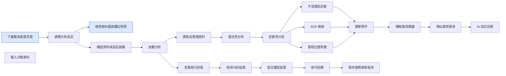

### 畫布：修改後

```mermaid
flowchart LR
  n_accept_upload["接受或丟棄上傳的檔案"]:::add
  n_approve_feedback["核可回饋"]
  n_check_data["檢查資料檔與欄位對照"]:::link
  n_check_ready["確認資料與設定就緒"]
  n_compile["彙整事件"]
  n_configure["調整分析設定"]
  n_descriptive["描述性分析"]
  n_diagnostic["診斷性分析"]
  n_get_templates["下載範本與需求表"]:::link
  n_llm["AI 綜合診斷"]
  n_load_demo["載入示範資料"]
  n_ng_code["不良類型診斷"]
  n_publish_library["發布案例庫新版本"]
  n_rag["SOP 檢索"]
  n_read_data["讀取並整理資料"]
  n_search_key["擷取搜尋關鍵"]
  n_similarity["相似案例搜尋"]
  n_start_run["啟動分析"]
  n_submit_feedback["提交確認結果"]
  n_topology["製程位置對應"]
  n_upload_files["上傳資料與設定檔並看驗證報告"]:::add
  n_view_results["取得分析結果"]
  n_view_run["查看執行狀態"]
  n_accept_upload --> n_check_data
  n_approve_feedback --> n_publish_library
  n_check_ready --> n_start_run
  n_compile --> n_search_key
  n_configure --> n_check_data
  n_configure --> n_check_ready
  n_descriptive --> n_diagnostic
  n_diagnostic --> n_ng_code
  n_diagnostic --> n_rag
  n_diagnostic --> n_topology
  n_get_templates --> n_configure
  n_get_templates --> n_upload_files
  n_ng_code --> n_compile
  n_rag --> n_compile
  n_read_data --> n_descriptive
  n_search_key --> n_similarity
  n_similarity --> n_llm
  n_start_run --> n_read_data
  n_start_run --> n_view_run
  n_submit_feedback --> n_approve_feedback
  n_topology --> n_compile
  n_upload_files --> n_accept_upload
  n_view_results --> n_submit_feedback
  n_view_run --> n_view_results
  classDef add fill:#d6f5dc,stroke:#2e7d32
  classDef remove fill:#fbd9d9,stroke:#c62828
  classDef edit fill:#fff3c4,stroke:#b58900
  classDef link fill:#dbe9ff,stroke:#1f5fbf
```

<details><summary>機器可讀資料</summary>

<!-- kit-changelog-entry -->
```json
{
  "seq": 5,
  "kitVersion": "0.1.0",
  "date": "2026-11-02",
  "author": "yucheng384752",
  "source": "git:15df790",
  "cause": "new-feature",
  "reason": "新增分段上傳與驗證報告：上傳檔案、接受上傳兩步取代直接餵資料",
  "nodes": [
    {
      "op": "add",
      "nodeId": "accept-upload",
      "nodeName": "接受或丟棄上傳的檔案",
      "after": {
        "id": "accept-upload",
        "name": "接受或丟棄上傳的檔案",
        "capabilityIds": [
          "analytical-four.uploads.accept",
          "analytical-four.uploads.discard"
        ]
      }
    },
    {
      "op": "add",
      "nodeId": "upload-files",
      "nodeName": "上傳資料與設定檔並看驗證報告",
      "after": {
        "id": "upload-files",
        "name": "上傳資料與設定檔並看驗證報告",
        "capabilityIds": [
          "analytical-four.uploads.create",
          "analytical-four.uploads.get",
          "analytical-four.uploads.list"
        ]
      }
    }
  ],
  "edges": [
    {
      "op": "add",
      "from": "accept-upload",
      "to": "check-data"
    },
    {
      "op": "add",
      "from": "get-templates",
      "to": "upload-files"
    },
    {
      "op": "add",
      "from": "upload-files",
      "to": "accept-upload"
    }
  ],
  "beforeSha": "9da2b2ca08803d292facfbbad8d7d67f36ceab42d3a28e23eb9045f554d2a85c",
  "afterSha": "a4af60ab00183e7189e85300a25392ee1735ecbb8ce33e4a97dc56b0a2ab61f7"
}
```

</details>

## #4　2026-11-02　new-feature

- 修改原因分類：新增功能：Kit 多了能力，流程跟著補節點
- 修改原因：新增可下載範本，使用者先取得範本再進入設定
- Kit 版本：0.1.0　作者：yucheng384752　來源：git:52cba51

### 被修改的節點

| 節點名稱（node_name） | node_id | 動作 | 變化 |
| --- | --- | --- | --- |
| 調整分析設定 | configure | 連線變更 | 新增連線「下載範本與需求表」→「調整分析設定」 |
| 下載範本與需求表 | get-templates | 新增 | 能力：analytical-four.templates.get、analytical-four.templates.list |

### 連線變更

- 新增連線：「下載範本與需求表」→「調整分析設定」

### 畫布：修改前

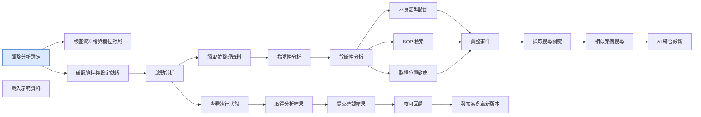

### 畫布：修改後

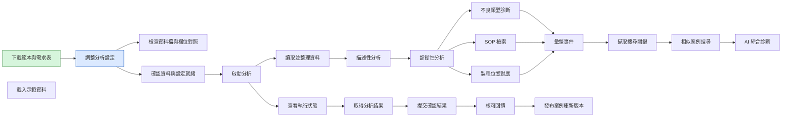

<details><summary>機器可讀資料</summary>

<!-- kit-changelog-entry -->
```json
{
  "seq": 4,
  "kitVersion": "0.1.0",
  "date": "2026-11-02",
  "author": "yucheng384752",
  "source": "git:52cba51",
  "cause": "new-feature",
  "reason": "新增可下載範本，使用者先取得範本再進入設定",
  "nodes": [
    {
      "op": "add",
      "nodeId": "get-templates",
      "nodeName": "下載範本與需求表",
      "after": {
        "id": "get-templates",
        "name": "下載範本與需求表",
        "capabilityIds": [
          "analytical-four.templates.get",
          "analytical-four.templates.list"
        ]
      }
    }
  ],
  "edges": [
    {
      "op": "add",
      "from": "get-templates",
      "to": "configure"
    }
  ],
  "beforeSha": "3b7d3849da236fae020f188c7ff9764d982b6d6c1afae9af0120a9b79a95ce4f",
  "afterSha": "9da2b2ca08803d292facfbbad8d7d67f36ceab42d3a28e23eb9045f554d2a85c"
}
```

</details>

## #3　2026-11-01　new-feature

- 修改原因分類：新增功能：Kit 多了能力，流程跟著補節點
- 修改原因：新增欄位對應、執行前資料檢查與清理揭露，流程在設定與開始分析之間多一步「檢查資料」
- Kit 版本：0.1.0　作者：yucheng384752　來源：git:b0a049a

### 被修改的節點

| 節點名稱（node_name） | node_id | 動作 | 變化 |
| --- | --- | --- | --- |
| 檢查資料檔與欄位對照 | check-data | 新增 | 能力：analytical-four.data.check |
| 調整分析設定 | configure | 連線變更 | 新增連線「調整分析設定」→「檢查資料檔與欄位對照」 |

### 連線變更

- 新增連線：「調整分析設定」→「檢查資料檔與欄位對照」

### 畫布：修改前

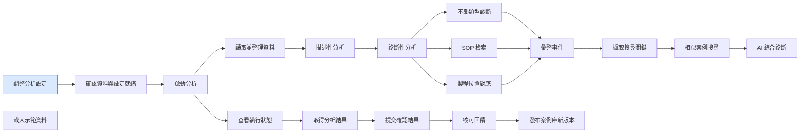

### 畫布：修改後

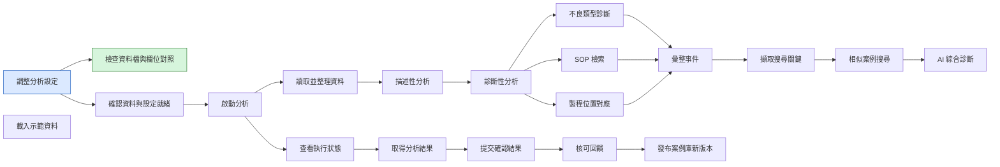

<details><summary>機器可讀資料</summary>

<!-- kit-changelog-entry -->
```json
{
  "seq": 3,
  "kitVersion": "0.1.0",
  "date": "2026-11-01",
  "author": "yucheng384752",
  "source": "git:b0a049a",
  "cause": "new-feature",
  "reason": "新增欄位對應、執行前資料檢查與清理揭露，流程在設定與開始分析之間多一步「檢查資料」",
  "nodes": [
    {
      "op": "add",
      "nodeId": "check-data",
      "nodeName": "檢查資料檔與欄位對照",
      "after": {
        "id": "check-data",
        "name": "檢查資料檔與欄位對照",
        "capabilityIds": [
          "analytical-four.data.check"
        ]
      }
    }
  ],
  "edges": [
    {
      "op": "add",
      "from": "configure",
      "to": "check-data"
    }
  ],
  "beforeSha": "bcad060a3e344466f93cc99802378cefb9668bbc6c44d6cd9910835bc9094e8c",
  "afterSha": "3b7d3849da236fae020f188c7ff9764d982b6d6c1afae9af0120a9b79a95ce4f"
}
```

</details>

## #2　2026-11-01　new-feature

- 修改原因分類：新增功能：Kit 多了能力，流程跟著補節點
- 修改原因：新增回饋核准與版本化案例庫：提交回饋、核准回饋、發布案例庫新版本三個步驟接在查看結果之後
- Kit 版本：0.1.0　作者：yucheng384752　來源：git:231b1cf

### 被修改的節點

| 節點名稱（node_name） | node_id | 動作 | 變化 |
| --- | --- | --- | --- |
| 核可回饋 | approve-feedback | 新增 | 能力：analytical-four.feedback.decide、analytical-four.feedback.list |
| 發布案例庫新版本 | publish-library | 新增 | 能力：analytical-four.library.publish、analytical-four.library.versions |
| 提交確認結果 | submit-feedback | 新增 | 能力：analytical-four.feedback.import、analytical-four.feedback.submit |
| 取得分析結果 | view-results | 連線變更 | 新增連線「取得分析結果」→「提交確認結果」 |

### 連線變更

- 新增連線：「核可回饋」→「發布案例庫新版本」
- 新增連線：「提交確認結果」→「核可回饋」
- 新增連線：「取得分析結果」→「提交確認結果」

### 畫布：修改前

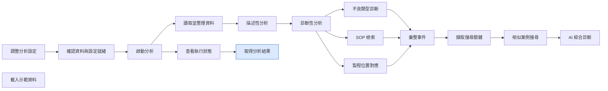

### 畫布：修改後

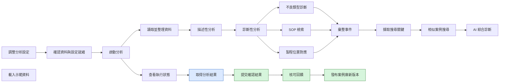

<details><summary>機器可讀資料</summary>

<!-- kit-changelog-entry -->
```json
{
  "seq": 2,
  "kitVersion": "0.1.0",
  "date": "2026-11-01",
  "author": "yucheng384752",
  "source": "git:231b1cf",
  "cause": "new-feature",
  "reason": "新增回饋核准與版本化案例庫：提交回饋、核准回饋、發布案例庫新版本三個步驟接在查看結果之後",
  "nodes": [
    {
      "op": "add",
      "nodeId": "approve-feedback",
      "nodeName": "核可回饋",
      "after": {
        "id": "approve-feedback",
        "name": "核可回饋",
        "subfeatureId": "layer-c",
        "capabilityIds": [
          "analytical-four.feedback.decide",
          "analytical-four.feedback.list"
        ]
      }
    },
    {
      "op": "add",
      "nodeId": "publish-library",
      "nodeName": "發布案例庫新版本",
      "after": {
        "id": "publish-library",
        "name": "發布案例庫新版本",
        "subfeatureId": "layer-c",
        "capabilityIds": [
          "analytical-four.library.publish",
          "analytical-four.library.versions"
        ]
      }
    },
    {
      "op": "add",
      "nodeId": "submit-feedback",
      "nodeName": "提交確認結果",
      "after": {
        "id": "submit-feedback",
        "name": "提交確認結果",
        "subfeatureId": "layer-c",
        "capabilityIds": [
          "analytical-four.feedback.import",
          "analytical-four.feedback.submit"
        ]
      }
    }
  ],
  "edges": [
    {
      "op": "add",
      "from": "approve-feedback",
      "to": "publish-library"
    },
    {
      "op": "add",
      "from": "submit-feedback",
      "to": "approve-feedback"
    },
    {
      "op": "add",
      "from": "view-results",
      "to": "submit-feedback"
    }
  ],
  "beforeSha": "76480ffec4ed3d1f1b0038773652f5212a5898d11dd7c39260de61d2d8ce3bdc",
  "afterSha": "bcad060a3e344466f93cc99802378cefb9668bbc6c44d6cd9910835bc9094e8c"
}
```

</details>

## #1　2026-11-01　initial

- 修改原因分類：初版：Kit 第一次建立流程描述
- 修改原因：初版建立（提交：feat(kits): add analytical-four-kit with A/B/C analysis layers and its own workflow description）
- Kit 版本：0.1.0　作者：yucheng384752　來源：git:df97771

### 被修改的節點

| 節點名稱（node_name） | node_id | 動作 | 變化 |
| --- | --- | --- | --- |
| 確認資料與設定就緒 | check-ready | 新增 | 能力：analytical-four.status.get |
| 彙整事件 | compile | 新增 | 能力：analytical-four.runs.create |
| 調整分析設定 | configure | 新增 | 能力：analytical-four.settings.get、analytical-four.settings.put |
| 描述性分析 | descriptive | 新增 | 能力：analytical-four.runs.create |
| 診斷性分析 | diagnostic | 新增 | 能力：analytical-four.runs.create |
| AI 綜合診斷 | llm | 新增 | 能力：analytical-four.runs.create |
| 載入示範資料 | load-demo | 新增 | 能力：analytical-four.demo.load |
| 不良類型診斷 | ng-code | 新增 | 能力：analytical-four.runs.create |
| SOP 檢索 | rag | 新增 | 能力：analytical-four.runs.create |
| 讀取並整理資料 | read-data | 新增 | 能力：analytical-four.runs.create |
| 擷取搜尋關鍵 | search-key | 新增 | 能力：analytical-four.runs.create |
| 相似案例搜尋 | similarity | 新增 | 能力：analytical-four.runs.create |
| 啟動分析 | start-run | 新增 | 能力：analytical-four.runs.create |
| 製程位置對應 | topology | 新增 | 能力：analytical-four.runs.create |
| 取得分析結果 | view-results | 新增 | 能力：analytical-four.results.get、analytical-four.results.list |
| 查看執行狀態 | view-run | 新增 | 能力：analytical-four.runs.get、analytical-four.runs.list |

### 連線變更

- 新增連線：「確認資料與設定就緒」→「啟動分析」
- 新增連線：「彙整事件」→「擷取搜尋關鍵」
- 新增連線：「調整分析設定」→「確認資料與設定就緒」
- 新增連線：「描述性分析」→「診斷性分析」
- 新增連線：「診斷性分析」→「不良類型診斷」
- 新增連線：「診斷性分析」→「SOP 檢索」
- 新增連線：「診斷性分析」→「製程位置對應」
- 新增連線：「不良類型診斷」→「彙整事件」
- 新增連線：「SOP 檢索」→「彙整事件」
- 新增連線：「讀取並整理資料」→「描述性分析」
- 新增連線：「擷取搜尋關鍵」→「相似案例搜尋」
- 新增連線：「相似案例搜尋」→「AI 綜合診斷」
- 新增連線：「啟動分析」→「讀取並整理資料」
- 新增連線：「啟動分析」→「查看執行狀態」
- 新增連線：「製程位置對應」→「彙整事件」
- 新增連線：「查看執行狀態」→「取得分析結果」

### 畫布：修改前

（尚無流程）

### 畫布：修改後

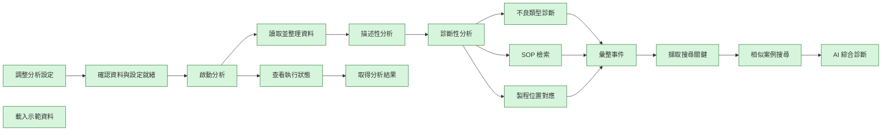

<details><summary>機器可讀資料</summary>

<!-- kit-changelog-entry -->
```json
{
  "seq": 1,
  "kitVersion": "0.1.0",
  "date": "2026-11-01",
  "author": "yucheng384752",
  "source": "git:df97771",
  "cause": "initial",
  "reason": "初版建立（提交：feat(kits): add analytical-four-kit with A/B/C analysis layers and its own workflow description）",
  "nodes": [
    {
      "op": "add",
      "nodeId": "check-ready",
      "nodeName": "確認資料與設定就緒",
      "after": {
        "id": "check-ready",
        "name": "確認資料與設定就緒",
        "capabilityIds": [
          "analytical-four.status.get"
        ]
      }
    },
    {
      "op": "add",
      "nodeId": "compile",
      "nodeName": "彙整事件",
      "after": {
        "id": "compile",
        "name": "彙整事件",
        "subfeatureId": "layer-c",
        "capabilityIds": [
          "analytical-four.runs.create"
        ]
      }
    },
    {
      "op": "add",
      "nodeId": "configure",
      "nodeName": "調整分析設定",
      "after": {
        "id": "configure",
        "name": "調整分析設定",
        "capabilityIds": [
          "analytical-four.settings.get",
          "analytical-four.settings.put"
        ]
      }
    },
    {
      "op": "add",
      "nodeId": "descriptive",
      "nodeName": "描述性分析",
      "after": {
        "id": "descriptive",
        "name": "描述性分析",
        "subfeatureId": "layer-a",
        "capabilityIds": [
          "analytical-four.runs.create"
        ]
      }
    },
    {
      "op": "add",
      "nodeId": "diagnostic",
      "nodeName": "診斷性分析",
      "after": {
        "id": "diagnostic",
        "name": "診斷性分析",
        "subfeatureId": "layer-a",
        "capabilityIds": [
          "analytical-four.runs.create"
        ]
      }
    },
    {
      "op": "add",
      "nodeId": "llm",
      "nodeName": "AI 綜合診斷",
      "after": {
        "id": "llm",
        "name": "AI 綜合診斷",
        "subfeatureId": "layer-c",
        "capabilityIds": [
          "analytical-four.runs.create"
        ]
      }
    },
    {
      "op": "add",
      "nodeId": "load-demo",
      "nodeName": "載入示範資料",
      "after": {
        "id": "load-demo",
        "name": "載入示範資料",
        "capabilityIds": [
          "analytical-four.demo.load"
        ]
      }
    },
    {
      "op": "add",
      "nodeId": "ng-code",
      "nodeName": "不良類型診斷",
      "after": {
        "id": "ng-code",
        "name": "不良類型診斷",
        "subfeatureId": "layer-b",
        "capabilityIds": [
          "analytical-four.runs.create"
        ]
      }
    },
    {
      "op": "add",
      "nodeId": "rag",
      "nodeName": "SOP 檢索",
      "after": {
        "id": "rag",
        "name": "SOP 檢索",
        "subfeatureId": "layer-c",
        "capabilityIds": [
          "analytical-four.runs.create"
        ]
      }
    },
    {
      "op": "add",
      "nodeId": "read-data",
      "nodeName": "讀取並整理資料",
      "after": {
        "id": "read-data",
        "name": "讀取並整理資料",
        "subfeatureId": "layer-a",
        "capabilityIds": [
          "analytical-four.runs.create"
        ]
      }
    },
    {
      "op": "add",
      "nodeId": "search-key",
      "nodeName": "擷取搜尋關鍵",
      "after": {
        "id": "search-key",
        "name": "擷取搜尋關鍵",
        "subfeatureId": "layer-c",
        "capabilityIds": [
          "analytical-four.runs.create"
        ]
      }
    },
    {
      "op": "add",
      "nodeId": "similarity",
      "nodeName": "相似案例搜尋",
      "after": {
        "id": "similarity",
        "name": "相似案例搜尋",
        "subfeatureId": "layer-c",
        "capabilityIds": [
          "analytical-four.runs.create"
        ]
      }
    },
    {
      "op": "add",
      "nodeId": "start-run",
      "nodeName": "啟動分析",
      "after": {
        "id": "start-run",
        "name": "啟動分析",
        "capabilityIds": [
          "analytical-four.runs.create"
        ]
      }
    },
    {
      "op": "add",
      "nodeId": "topology",
      "nodeName": "製程位置對應",
      "after": {
        "id": "topology",
        "name": "製程位置對應",
        "subfeatureId": "layer-c",
        "capabilityIds": [
          "analytical-four.runs.create"
        ]
      }
    },
    {
      "op": "add",
      "nodeId": "view-results",
      "nodeName": "取得分析結果",
      "after": {
        "id": "view-results",
        "name": "取得分析結果",
        "capabilityIds": [
          "analytical-four.results.get",
          "analytical-four.results.list"
        ]
      }
    },
    {
      "op": "add",
      "nodeId": "view-run",
      "nodeName": "查看執行狀態",
      "after": {
        "id": "view-run",
        "name": "查看執行狀態",
        "capabilityIds": [
          "analytical-four.runs.get",
          "analytical-four.runs.list"
        ]
      }
    }
  ],
  "edges": [
    {
      "op": "add",
      "from": "check-ready",
      "to": "start-run"
    },
    {
      "op": "add",
      "from": "compile",
      "to": "search-key"
    },
    {
      "op": "add",
      "from": "configure",
      "to": "check-ready"
    },
    {
      "op": "add",
      "from": "descriptive",
      "to": "diagnostic"
    },
    {
      "op": "add",
      "from": "diagnostic",
      "to": "ng-code"
    },
    {
      "op": "add",
      "from": "diagnostic",
      "to": "rag"
    },
    {
      "op": "add",
      "from": "diagnostic",
      "to": "topology"
    },
    {
      "op": "add",
      "from": "ng-code",
      "to": "compile"
    },
    {
      "op": "add",
      "from": "rag",
      "to": "compile"
    },
    {
      "op": "add",
      "from": "read-data",
      "to": "descriptive"
    },
    {
      "op": "add",
      "from": "search-key",
      "to": "similarity"
    },
    {
      "op": "add",
      "from": "similarity",
      "to": "llm"
    },
    {
      "op": "add",
      "from": "start-run",
      "to": "read-data"
    },
    {
      "op": "add",
      "from": "start-run",
      "to": "view-run"
    },
    {
      "op": "add",
      "from": "topology",
      "to": "compile"
    },
    {
      "op": "add",
      "from": "view-run",
      "to": "view-results"
    }
  ],
  "beforeSha": "a461bf77bc4e4d732f7afc121c70e7f70ed8bf225a082a4e01951d1eb6b5c278",
  "afterSha": "76480ffec4ed3d1f1b0038773652f5212a5898d11dd7c39260de61d2d8ce3bdc"
}
```

</details>
