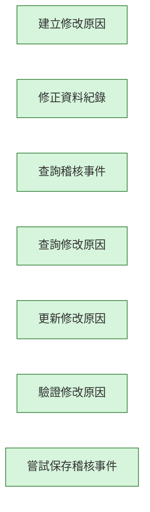

# audit-edit-kit 變更紀錄

本檔記錄這個 Kit 的作業流程（`workflow.aov.json`）每次修改了哪些節點、為什麼改、改前改後的畫布長什麼樣。
它由 `node scripts/kit-changelog.mjs` 產生，請不要手改；改了流程描述後執行 `add` 補一筆（見 `docs/kit-authoring.md`）。
測試會檢查：紀錄從空白依序重播後必須等於目前的流程描述，且本檔文字與機器可讀資料一致。

| 修改原因分類 | 意義 |
| --- | --- |
| initial | 初版：Kit 第一次建立流程描述 |
| new-feature | 新增功能：Kit 多了能力，流程跟著補節點 |
| align-runtime | 對齊實際行為：流程描述與實際程式行為不符，已修正 |
| wording | 用語調整：節點名稱改成更精確或更貼近業務的說法 |
| dependency | 前置關係：調整哪一步必須先完成哪一步 |
| granularity | 粒度調整：節點拆分、合併或移除重複 |
| verification-finding | 實測發現：在測試機實際操作後發現需要修改 |
| other | 其他：須在修改原因寫清楚 |

## #1　2026-10-18　initial

- 修改原因分類：初版：Kit 第一次建立流程描述
- 修改原因：初版建立（提交：feat(kits): add draft workflow descriptions for nine kits (D100)）
- Kit 版本：c4b2b7b-ui.1　作者：yucheng384752　來源：git:54e4c1b

### 被修改的節點

| 節點名稱（node_name） | node_id | 動作 | 變化 |
| --- | --- | --- | --- |
| 建立修改原因 | create-reason | 新增 | 能力：edit-reasons.create |
| 修正資料紀錄 | edit-record | 新增 | 能力：records.edit |
| 查詢稽核事件 | list-audit | 新增 | 能力：audit.events.list |
| 查詢修改原因 | list-reasons | 新增 | 能力：edit-reasons.list |
| 更新修改原因 | update-reason | 新增 | 能力：edit-reasons.update |
| 驗證修改原因 | validate-reason | 新增 | 能力：db.edit-reasons.validate |
| 嘗試保存稽核事件 | write-audit | 新增 | 能力：db.audit.events |

### 畫布：修改前

（尚無流程）

### 畫布：修改後



<details><summary>機器可讀資料</summary>

<!-- kit-changelog-entry -->
```json
{
  "seq": 1,
  "kitVersion": "c4b2b7b-ui.1",
  "date": "2026-10-18",
  "author": "yucheng384752",
  "source": "git:54e4c1b",
  "cause": "initial",
  "reason": "初版建立（提交：feat(kits): add draft workflow descriptions for nine kits (D100)）",
  "nodes": [
    {
      "op": "add",
      "nodeId": "create-reason",
      "nodeName": "建立修改原因",
      "after": {
        "id": "create-reason",
        "name": "建立修改原因",
        "subfeatureId": "edit-reason",
        "capabilityIds": [
          "edit-reasons.create"
        ]
      }
    },
    {
      "op": "add",
      "nodeId": "edit-record",
      "nodeName": "修正資料紀錄",
      "after": {
        "id": "edit-record",
        "name": "修正資料紀錄",
        "subfeatureId": "record-correction",
        "capabilityIds": [
          "records.edit"
        ]
      }
    },
    {
      "op": "add",
      "nodeId": "list-audit",
      "nodeName": "查詢稽核事件",
      "after": {
        "id": "list-audit",
        "name": "查詢稽核事件",
        "subfeatureId": "audit-event-query",
        "capabilityIds": [
          "audit.events.list"
        ]
      }
    },
    {
      "op": "add",
      "nodeId": "list-reasons",
      "nodeName": "查詢修改原因",
      "after": {
        "id": "list-reasons",
        "name": "查詢修改原因",
        "subfeatureId": "edit-reason",
        "capabilityIds": [
          "edit-reasons.list"
        ]
      }
    },
    {
      "op": "add",
      "nodeId": "update-reason",
      "nodeName": "更新修改原因",
      "after": {
        "id": "update-reason",
        "name": "更新修改原因",
        "subfeatureId": "edit-reason",
        "capabilityIds": [
          "edit-reasons.update"
        ]
      }
    },
    {
      "op": "add",
      "nodeId": "validate-reason",
      "nodeName": "驗證修改原因",
      "after": {
        "id": "validate-reason",
        "name": "驗證修改原因",
        "subfeatureId": "edit-reason",
        "capabilityIds": [
          "db.edit-reasons.validate"
        ]
      }
    },
    {
      "op": "add",
      "nodeId": "write-audit",
      "nodeName": "嘗試保存稽核事件",
      "after": {
        "id": "write-audit",
        "name": "嘗試保存稽核事件",
        "capabilityIds": [
          "db.audit.events"
        ]
      }
    }
  ],
  "edges": [],
  "beforeSha": "a461bf77bc4e4d732f7afc121c70e7f70ed8bf225a082a4e01951d1eb6b5c278",
  "afterSha": "8b78b9d2e18c3063e74bde1ce7e01f4f7217355e637a7310d880ecf6484337d1"
}
```

</details>
