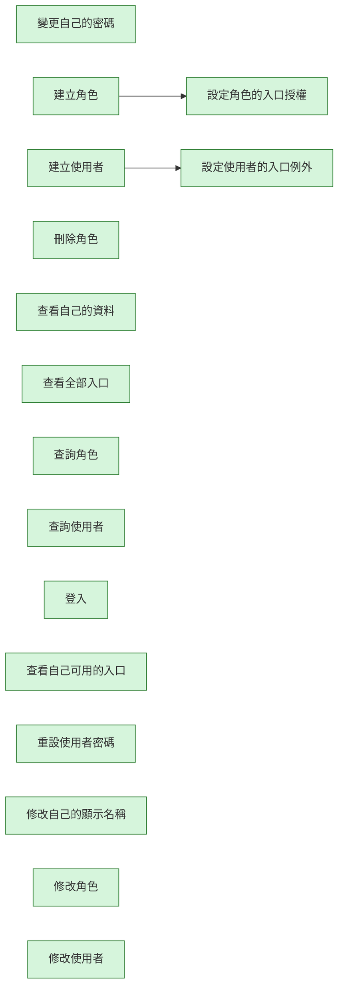

# entry-permission-kit 變更紀錄

本檔記錄這個 Kit 的作業流程（`workflow.aov.json`）每次修改了哪些節點、為什麼改、改前改後的畫布長什麼樣。
它由 `node scripts/kit-changelog.mjs` 產生，請不要手改；改了流程描述後執行 `add` 補一筆（見 `docs/kit-authoring.md`）。
測試會檢查：紀錄從空白依序重播後必須等於目前的流程描述，且本檔文字與機器可讀資料一致。

| 修改原因分類 | 意義 |
| --- | --- |
| initial | 初版：Kit 第一次建立流程描述 |
| new-feature | 新增功能：Kit 多了能力，流程跟著補節點 |
| align-runtime | 對齊實際行為：流程描述與實際程式行為不符，已修正 |
| wording | 用語調整：節點名稱改成更精確或更貼近業務的說法 |
| dependency | 前置關係：調整哪一步必須先完成哪一步 |
| granularity | 粒度調整：節點拆分、合併或移除重複 |
| verification-finding | 實測發現：在測試機實際操作後發現需要修改 |
| other | 其他：須在修改原因寫清楚 |

## #1　2026-10-30　initial

- 修改原因分類：初版：Kit 第一次建立流程描述
- 修改原因：初版建立（提交：feat(kits): add registry and workflow description for factory-core-kit and entry-permission-kit）
- Kit 版本：0.1.0　作者：yucheng384752　來源：git:994c9b0

### 被修改的節點

| 節點名稱（node_name） | node_id | 動作 | 變化 |
| --- | --- | --- | --- |
| 變更自己的密碼 | change-password | 新增 | 能力：auth.change-password |
| 建立角色 | create-role | 新增 | 能力：roles.create |
| 建立使用者 | create-user | 新增 | 能力：ep.users.create |
| 刪除角色 | delete-role | 新增 | 能力：roles.delete |
| 查看自己的資料 | get-me | 新增 | 能力：auth.me.get |
| 查看全部入口 | list-entry-points | 新增 | 能力：entry-points.list |
| 查詢角色 | list-roles | 新增 | 能力：roles.list |
| 查詢使用者 | list-users | 新增 | 能力：ep.users.list |
| 登入 | login | 新增 | 能力：auth.login |
| 查看自己可用的入口 | my-entry-points | 新增 | 能力：entry-points.me |
| 重設使用者密碼 | reset-password | 新增 | 能力：ep.users.reset-password |
| 設定角色的入口授權 | set-role-grants | 新增 | 能力：roles.grants.put |
| 設定使用者的入口例外 | set-user-overrides | 新增 | 能力：ep.users.overrides.put |
| 修改自己的顯示名稱 | update-me | 新增 | 能力：auth.me.update |
| 修改角色 | update-role | 新增 | 能力：roles.update |
| 修改使用者 | update-user | 新增 | 能力：ep.users.update |

### 連線變更

- 新增連線：「建立角色」→「設定角色的入口授權」
- 新增連線：「建立使用者」→「設定使用者的入口例外」

### 畫布：修改前

（尚無流程）

### 畫布：修改後



<details><summary>機器可讀資料</summary>

<!-- kit-changelog-entry -->
```json
{
  "seq": 1,
  "kitVersion": "0.1.0",
  "date": "2026-10-30",
  "author": "yucheng384752",
  "source": "git:994c9b0",
  "cause": "initial",
  "reason": "初版建立（提交：feat(kits): add registry and workflow description for factory-core-kit and entry-permission-kit）",
  "nodes": [
    {
      "op": "add",
      "nodeId": "change-password",
      "nodeName": "變更自己的密碼",
      "after": {
        "id": "change-password",
        "name": "變更自己的密碼",
        "capabilityIds": [
          "auth.change-password"
        ]
      }
    },
    {
      "op": "add",
      "nodeId": "create-role",
      "nodeName": "建立角色",
      "after": {
        "id": "create-role",
        "name": "建立角色",
        "capabilityIds": [
          "roles.create"
        ]
      }
    },
    {
      "op": "add",
      "nodeId": "create-user",
      "nodeName": "建立使用者",
      "after": {
        "id": "create-user",
        "name": "建立使用者",
        "capabilityIds": [
          "ep.users.create"
        ]
      }
    },
    {
      "op": "add",
      "nodeId": "delete-role",
      "nodeName": "刪除角色",
      "after": {
        "id": "delete-role",
        "name": "刪除角色",
        "capabilityIds": [
          "roles.delete"
        ]
      }
    },
    {
      "op": "add",
      "nodeId": "get-me",
      "nodeName": "查看自己的資料",
      "after": {
        "id": "get-me",
        "name": "查看自己的資料",
        "capabilityIds": [
          "auth.me.get"
        ]
      }
    },
    {
      "op": "add",
      "nodeId": "list-entry-points",
      "nodeName": "查看全部入口",
      "after": {
        "id": "list-entry-points",
        "name": "查看全部入口",
        "capabilityIds": [
          "entry-points.list"
        ]
      }
    },
    {
      "op": "add",
      "nodeId": "list-roles",
      "nodeName": "查詢角色",
      "after": {
        "id": "list-roles",
        "name": "查詢角色",
        "capabilityIds": [
          "roles.list"
        ]
      }
    },
    {
      "op": "add",
      "nodeId": "list-users",
      "nodeName": "查詢使用者",
      "after": {
        "id": "list-users",
        "name": "查詢使用者",
        "capabilityIds": [
          "ep.users.list"
        ]
      }
    },
    {
      "op": "add",
      "nodeId": "login",
      "nodeName": "登入",
      "after": {
        "id": "login",
        "name": "登入",
        "capabilityIds": [
          "auth.login"
        ]
      }
    },
    {
      "op": "add",
      "nodeId": "my-entry-points",
      "nodeName": "查看自己可用的入口",
      "after": {
        "id": "my-entry-points",
        "name": "查看自己可用的入口",
        "capabilityIds": [
          "entry-points.me"
        ]
      }
    },
    {
      "op": "add",
      "nodeId": "reset-password",
      "nodeName": "重設使用者密碼",
      "after": {
        "id": "reset-password",
        "name": "重設使用者密碼",
        "capabilityIds": [
          "ep.users.reset-password"
        ]
      }
    },
    {
      "op": "add",
      "nodeId": "set-role-grants",
      "nodeName": "設定角色的入口授權",
      "after": {
        "id": "set-role-grants",
        "name": "設定角色的入口授權",
        "capabilityIds": [
          "roles.grants.put"
        ]
      }
    },
    {
      "op": "add",
      "nodeId": "set-user-overrides",
      "nodeName": "設定使用者的入口例外",
      "after": {
        "id": "set-user-overrides",
        "name": "設定使用者的入口例外",
        "capabilityIds": [
          "ep.users.overrides.put"
        ]
      }
    },
    {
      "op": "add",
      "nodeId": "update-me",
      "nodeName": "修改自己的顯示名稱",
      "after": {
        "id": "update-me",
        "name": "修改自己的顯示名稱",
        "capabilityIds": [
          "auth.me.update"
        ]
      }
    },
    {
      "op": "add",
      "nodeId": "update-role",
      "nodeName": "修改角色",
      "after": {
        "id": "update-role",
        "name": "修改角色",
        "capabilityIds": [
          "roles.update"
        ]
      }
    },
    {
      "op": "add",
      "nodeId": "update-user",
      "nodeName": "修改使用者",
      "after": {
        "id": "update-user",
        "name": "修改使用者",
        "capabilityIds": [
          "ep.users.update"
        ]
      }
    }
  ],
  "edges": [
    {
      "op": "add",
      "from": "create-role",
      "to": "set-role-grants"
    },
    {
      "op": "add",
      "from": "create-user",
      "to": "set-user-overrides"
    }
  ],
  "beforeSha": "a461bf77bc4e4d732f7afc121c70e7f70ed8bf225a082a4e01951d1eb6b5c278",
  "afterSha": "fac390fa537a73bc3d8ddb980d9ee6fd66086c80e706a83ab13cafec7dbb3b1e"
}
```

</details>
