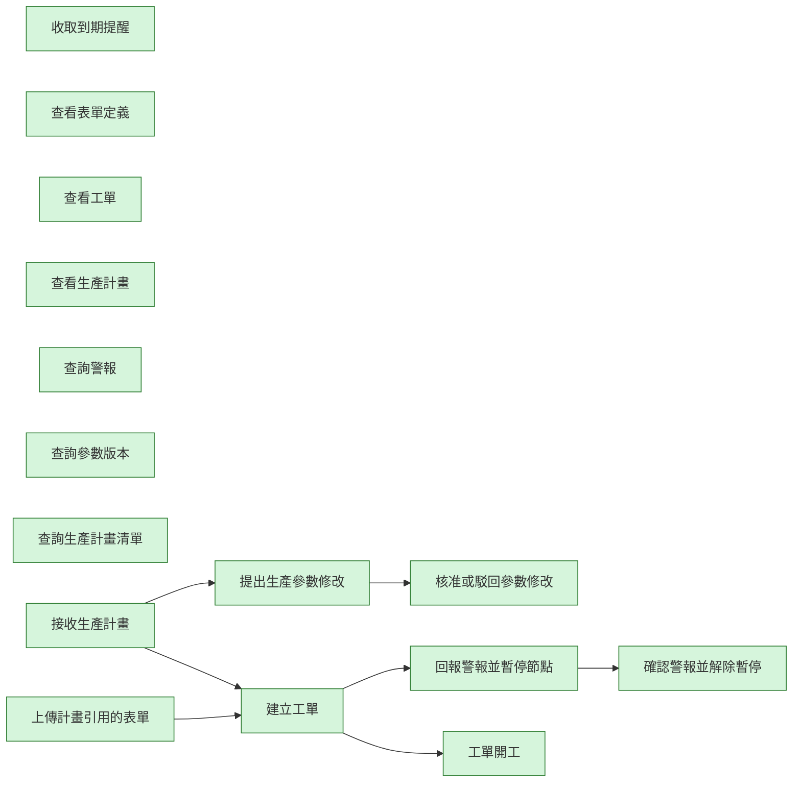

# factory-core-kit 變更紀錄

本檔記錄這個 Kit 的作業流程（`workflow.aov.json`）每次修改了哪些節點、為什麼改、改前改後的畫布長什麼樣。
它由 `node scripts/kit-changelog.mjs` 產生，請不要手改；改了流程描述後執行 `add` 補一筆（見 `docs/kit-authoring.md`）。
測試會檢查：紀錄從空白依序重播後必須等於目前的流程描述，且本檔文字與機器可讀資料一致。

| 修改原因分類 | 意義 |
| --- | --- |
| initial | 初版：Kit 第一次建立流程描述 |
| new-feature | 新增功能：Kit 多了能力，流程跟著補節點 |
| align-runtime | 對齊實際行為：流程描述與實際程式行為不符，已修正 |
| wording | 用語調整：節點名稱改成更精確或更貼近業務的說法 |
| dependency | 前置關係：調整哪一步必須先完成哪一步 |
| granularity | 粒度調整：節點拆分、合併或移除重複 |
| verification-finding | 實測發現：在測試機實際操作後發現需要修改 |
| other | 其他：須在修改原因寫清楚 |

## #1　2026-10-30　initial

- 修改原因分類：初版：Kit 第一次建立流程描述
- 修改原因：初版建立（提交：feat(kits): add registry and workflow description for factory-core-kit and entry-permission-kit）
- Kit 版本：0.1.0　作者：yucheng384752　來源：git:994c9b0

### 被修改的節點

| 節點名稱（node_name） | node_id | 動作 | 變化 |
| --- | --- | --- | --- |
| 確認警報並解除暫停 | acknowledge-alarm | 新增 | 能力：factory.alarms.acknowledge |
| 收取到期提醒 | collect-reminders | 新增 | 能力：factory.alarms.remind |
| 建立工單 | create-order | 新增 | 能力：factory.orders.create |
| 核准或駁回參數修改 | decide-params | 新增 | 能力：factory.params.decide |
| 查看表單定義 | get-form | 新增 | 能力：factory.forms.get |
| 查看工單 | get-order | 新增 | 能力：factory.orders.get |
| 查看生產計畫 | get-plan | 新增 | 能力：factory.plans.get |
| 查詢警報 | list-alarms | 新增 | 能力：factory.alarms.list |
| 查詢參數版本 | list-params | 新增 | 能力：factory.params.list |
| 查詢生產計畫清單 | list-plans | 新增 | 能力：factory.plans.list |
| 提出生產參數修改 | propose-params | 新增 | 能力：factory.params.propose |
| 回報警報並暫停節點 | raise-alarm | 新增 | 能力：factory.alarms.raise |
| 接收生產計畫 | receive-plan | 新增 | 能力：factory.plans.receive |
| 工單開工 | start-order | 新增 | 能力：factory.orders.start |
| 上傳計畫引用的表單 | upload-form | 新增 | 能力：factory.forms.upload |

### 連線變更

- 新增連線：「建立工單」→「回報警報並暫停節點」
- 新增連線：「建立工單」→「工單開工」
- 新增連線：「提出生產參數修改」→「核准或駁回參數修改」
- 新增連線：「回報警報並暫停節點」→「確認警報並解除暫停」
- 新增連線：「接收生產計畫」→「建立工單」
- 新增連線：「接收生產計畫」→「提出生產參數修改」
- 新增連線：「上傳計畫引用的表單」→「建立工單」

### 畫布：修改前

（尚無流程）

### 畫布：修改後



<details><summary>機器可讀資料</summary>

<!-- kit-changelog-entry -->
```json
{
  "seq": 1,
  "kitVersion": "0.1.0",
  "date": "2026-10-30",
  "author": "yucheng384752",
  "source": "git:994c9b0",
  "cause": "initial",
  "reason": "初版建立（提交：feat(kits): add registry and workflow description for factory-core-kit and entry-permission-kit）",
  "nodes": [
    {
      "op": "add",
      "nodeId": "acknowledge-alarm",
      "nodeName": "確認警報並解除暫停",
      "after": {
        "id": "acknowledge-alarm",
        "name": "確認警報並解除暫停",
        "capabilityIds": [
          "factory.alarms.acknowledge"
        ]
      }
    },
    {
      "op": "add",
      "nodeId": "collect-reminders",
      "nodeName": "收取到期提醒",
      "after": {
        "id": "collect-reminders",
        "name": "收取到期提醒",
        "capabilityIds": [
          "factory.alarms.remind"
        ]
      }
    },
    {
      "op": "add",
      "nodeId": "create-order",
      "nodeName": "建立工單",
      "after": {
        "id": "create-order",
        "name": "建立工單",
        "capabilityIds": [
          "factory.orders.create"
        ]
      }
    },
    {
      "op": "add",
      "nodeId": "decide-params",
      "nodeName": "核准或駁回參數修改",
      "after": {
        "id": "decide-params",
        "name": "核准或駁回參數修改",
        "capabilityIds": [
          "factory.params.decide"
        ]
      }
    },
    {
      "op": "add",
      "nodeId": "get-form",
      "nodeName": "查看表單定義",
      "after": {
        "id": "get-form",
        "name": "查看表單定義",
        "capabilityIds": [
          "factory.forms.get"
        ]
      }
    },
    {
      "op": "add",
      "nodeId": "get-order",
      "nodeName": "查看工單",
      "after": {
        "id": "get-order",
        "name": "查看工單",
        "capabilityIds": [
          "factory.orders.get"
        ]
      }
    },
    {
      "op": "add",
      "nodeId": "get-plan",
      "nodeName": "查看生產計畫",
      "after": {
        "id": "get-plan",
        "name": "查看生產計畫",
        "capabilityIds": [
          "factory.plans.get"
        ]
      }
    },
    {
      "op": "add",
      "nodeId": "list-alarms",
      "nodeName": "查詢警報",
      "after": {
        "id": "list-alarms",
        "name": "查詢警報",
        "capabilityIds": [
          "factory.alarms.list"
        ]
      }
    },
    {
      "op": "add",
      "nodeId": "list-params",
      "nodeName": "查詢參數版本",
      "after": {
        "id": "list-params",
        "name": "查詢參數版本",
        "capabilityIds": [
          "factory.params.list"
        ]
      }
    },
    {
      "op": "add",
      "nodeId": "list-plans",
      "nodeName": "查詢生產計畫清單",
      "after": {
        "id": "list-plans",
        "name": "查詢生產計畫清單",
        "capabilityIds": [
          "factory.plans.list"
        ]
      }
    },
    {
      "op": "add",
      "nodeId": "propose-params",
      "nodeName": "提出生產參數修改",
      "after": {
        "id": "propose-params",
        "name": "提出生產參數修改",
        "capabilityIds": [
          "factory.params.propose"
        ]
      }
    },
    {
      "op": "add",
      "nodeId": "raise-alarm",
      "nodeName": "回報警報並暫停節點",
      "after": {
        "id": "raise-alarm",
        "name": "回報警報並暫停節點",
        "capabilityIds": [
          "factory.alarms.raise"
        ]
      }
    },
    {
      "op": "add",
      "nodeId": "receive-plan",
      "nodeName": "接收生產計畫",
      "after": {
        "id": "receive-plan",
        "name": "接收生產計畫",
        "capabilityIds": [
          "factory.plans.receive"
        ]
      }
    },
    {
      "op": "add",
      "nodeId": "start-order",
      "nodeName": "工單開工",
      "after": {
        "id": "start-order",
        "name": "工單開工",
        "capabilityIds": [
          "factory.orders.start"
        ]
      }
    },
    {
      "op": "add",
      "nodeId": "upload-form",
      "nodeName": "上傳計畫引用的表單",
      "after": {
        "id": "upload-form",
        "name": "上傳計畫引用的表單",
        "capabilityIds": [
          "factory.forms.upload"
        ]
      }
    }
  ],
  "edges": [
    {
      "op": "add",
      "from": "create-order",
      "to": "raise-alarm"
    },
    {
      "op": "add",
      "from": "create-order",
      "to": "start-order"
    },
    {
      "op": "add",
      "from": "propose-params",
      "to": "decide-params"
    },
    {
      "op": "add",
      "from": "raise-alarm",
      "to": "acknowledge-alarm"
    },
    {
      "op": "add",
      "from": "receive-plan",
      "to": "create-order"
    },
    {
      "op": "add",
      "from": "receive-plan",
      "to": "propose-params"
    },
    {
      "op": "add",
      "from": "upload-form",
      "to": "create-order"
    }
  ],
  "beforeSha": "a461bf77bc4e4d732f7afc121c70e7f70ed8bf225a082a4e01951d1eb6b5c278",
  "afterSha": "4d3ce794c4401058c5cf20d09be03e00ea9439031e6707a588824bcf2f79959c"
}
```

</details>
