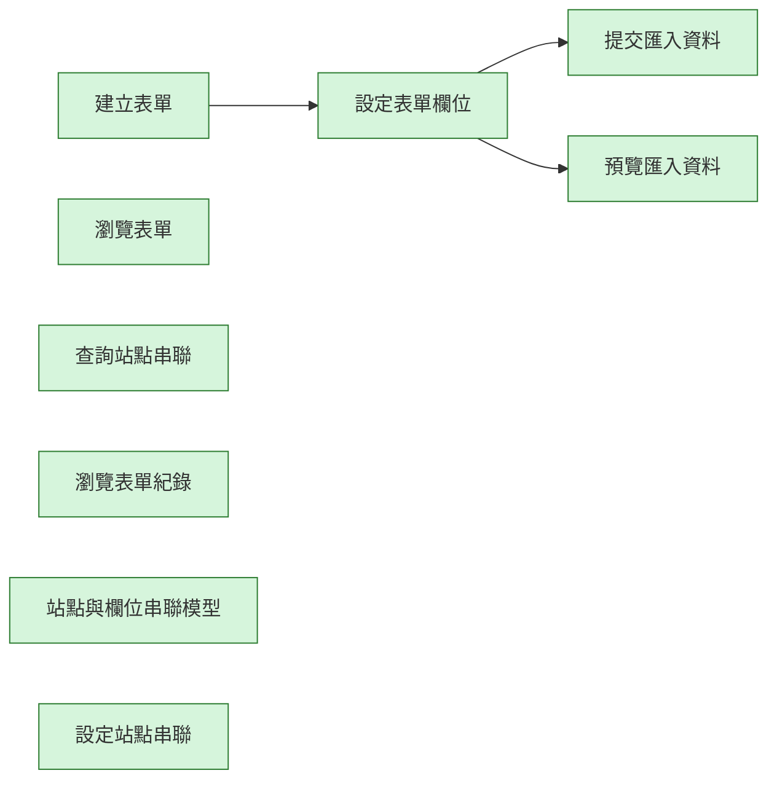

# generic-forms-kit 變更紀錄

本檔記錄這個 Kit 的作業流程（`workflow.aov.json`）每次修改了哪些節點、為什麼改、改前改後的畫布長什麼樣。
它由 `node scripts/kit-changelog.mjs` 產生，請不要手改；改了流程描述後執行 `add` 補一筆（見 `docs/kit-authoring.md`）。
測試會檢查：紀錄從空白依序重播後必須等於目前的流程描述，且本檔文字與機器可讀資料一致。

| 修改原因分類 | 意義 |
| --- | --- |
| initial | 初版：Kit 第一次建立流程描述 |
| new-feature | 新增功能：Kit 多了能力，流程跟著補節點 |
| align-runtime | 對齊實際行為：流程描述與實際程式行為不符，已修正 |
| wording | 用語調整：節點名稱改成更精確或更貼近業務的說法 |
| dependency | 前置關係：調整哪一步必須先完成哪一步 |
| granularity | 粒度調整：節點拆分、合併或移除重複 |
| verification-finding | 實測發現：在測試機實際操作後發現需要修改 |
| other | 其他：須在修改原因寫清楚 |

## #1　2026-10-18　initial

- 修改原因分類：初版：Kit 第一次建立流程描述
- 修改原因：初版建立（提交：feat(kits): add draft workflow descriptions for nine kits (D100)）
- Kit 版本：c4b2b7b-ui.1　作者：yucheng384752　來源：git:54e4c1b

### 被修改的節點

| 節點名稱（node_name） | node_id | 動作 | 變化 |
| --- | --- | --- | --- |
| 提交匯入資料 | commit-import | 新增 | 能力：forms.import.commit |
| 建立表單 | create-form | 新增 | 能力：forms.create |
| 瀏覽表單 | list-forms | 新增 | 能力：forms.list |
| 查詢站點串聯 | list-links | 新增 | 能力：dataflows.links.list |
| 瀏覽表單紀錄 | list-records | 新增 | 能力：forms.records.list |
| 預覽匯入資料 | preview-import | 新增 | 能力：forms.import.preview |
| 設定表單欄位 | set-schema | 新增 | 能力：forms.schema.set |
| 站點與欄位串聯模型 | station-model | 新增 | 能力：forms.station-model |
| 設定站點串聯 | upsert-link | 新增 | 能力：dataflows.links.upsert |

### 連線變更

- 新增連線：「建立表單」→「設定表單欄位」
- 新增連線：「設定表單欄位」→「提交匯入資料」
- 新增連線：「設定表單欄位」→「預覽匯入資料」

### 畫布：修改前

（尚無流程）

### 畫布：修改後



<details><summary>機器可讀資料</summary>

<!-- kit-changelog-entry -->
```json
{
  "seq": 1,
  "kitVersion": "c4b2b7b-ui.1",
  "date": "2026-10-18",
  "author": "yucheng384752",
  "source": "git:54e4c1b",
  "cause": "initial",
  "reason": "初版建立（提交：feat(kits): add draft workflow descriptions for nine kits (D100)）",
  "nodes": [
    {
      "op": "add",
      "nodeId": "commit-import",
      "nodeName": "提交匯入資料",
      "after": {
        "id": "commit-import",
        "name": "提交匯入資料",
        "subfeatureId": "form-record-upload",
        "capabilityIds": [
          "forms.import.commit"
        ]
      }
    },
    {
      "op": "add",
      "nodeId": "create-form",
      "nodeName": "建立表單",
      "after": {
        "id": "create-form",
        "name": "建立表單",
        "subfeatureId": "form-type-management",
        "capabilityIds": [
          "forms.create"
        ]
      }
    },
    {
      "op": "add",
      "nodeId": "list-forms",
      "nodeName": "瀏覽表單",
      "after": {
        "id": "list-forms",
        "name": "瀏覽表單",
        "subfeatureId": "form-type-management",
        "capabilityIds": [
          "forms.list"
        ]
      }
    },
    {
      "op": "add",
      "nodeId": "list-links",
      "nodeName": "查詢站點串聯",
      "after": {
        "id": "list-links",
        "name": "查詢站點串聯",
        "capabilityIds": [
          "dataflows.links.list"
        ]
      }
    },
    {
      "op": "add",
      "nodeId": "list-records",
      "nodeName": "瀏覽表單紀錄",
      "after": {
        "id": "list-records",
        "name": "瀏覽表單紀錄",
        "subfeatureId": "form-record-browser",
        "capabilityIds": [
          "forms.records.list"
        ]
      }
    },
    {
      "op": "add",
      "nodeId": "preview-import",
      "nodeName": "預覽匯入資料",
      "after": {
        "id": "preview-import",
        "name": "預覽匯入資料",
        "subfeatureId": "form-record-upload",
        "capabilityIds": [
          "forms.import.preview"
        ]
      }
    },
    {
      "op": "add",
      "nodeId": "set-schema",
      "nodeName": "設定表單欄位",
      "after": {
        "id": "set-schema",
        "name": "設定表單欄位",
        "subfeatureId": "form-schema-editor",
        "capabilityIds": [
          "forms.schema.set"
        ]
      }
    },
    {
      "op": "add",
      "nodeId": "station-model",
      "nodeName": "站點與欄位串聯模型",
      "after": {
        "id": "station-model",
        "name": "站點與欄位串聯模型",
        "capabilityIds": [
          "forms.station-model"
        ]
      }
    },
    {
      "op": "add",
      "nodeId": "upsert-link",
      "nodeName": "設定站點串聯",
      "after": {
        "id": "upsert-link",
        "name": "設定站點串聯",
        "capabilityIds": [
          "dataflows.links.upsert"
        ]
      }
    }
  ],
  "edges": [
    {
      "op": "add",
      "from": "create-form",
      "to": "set-schema"
    },
    {
      "op": "add",
      "from": "set-schema",
      "to": "commit-import"
    },
    {
      "op": "add",
      "from": "set-schema",
      "to": "preview-import"
    }
  ],
  "beforeSha": "a461bf77bc4e4d732f7afc121c70e7f70ed8bf225a082a4e01951d1eb6b5c278",
  "afterSha": "126078ec1b2758631fa41fddb322032ccc484aa3d37c3a1f281d032751558917"
}
```

</details>
