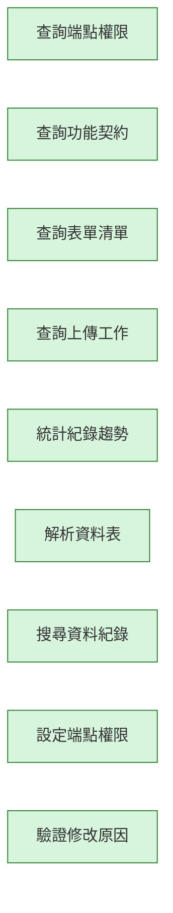

# platform-core-kit 變更紀錄

本檔記錄這個 Kit 的作業流程（`workflow.aov.json`）每次修改了哪些節點、為什麼改、改前改後的畫布長什麼樣。
它由 `node scripts/kit-changelog.mjs` 產生，請不要手改；改了流程描述後執行 `add` 補一筆（見 `docs/kit-authoring.md`）。
測試會檢查：紀錄從空白依序重播後必須等於目前的流程描述，且本檔文字與機器可讀資料一致。

| 修改原因分類 | 意義 |
| --- | --- |
| initial | 初版：Kit 第一次建立流程描述 |
| new-feature | 新增功能：Kit 多了能力，流程跟著補節點 |
| align-runtime | 對齊實際行為：流程描述與實際程式行為不符，已修正 |
| wording | 用語調整：節點名稱改成更精確或更貼近業務的說法 |
| dependency | 前置關係：調整哪一步必須先完成哪一步 |
| granularity | 粒度調整：節點拆分、合併或移除重複 |
| verification-finding | 實測發現：在測試機實際操作後發現需要修改 |
| other | 其他：須在修改原因寫清楚 |

## #1　2026-10-18　initial

- 修改原因分類：初版：Kit 第一次建立流程描述
- 修改原因：初版建立（提交：feat(kits): add draft workflow descriptions for nine kits (D100)）
- Kit 版本：c4b2b7b-ui.1　作者：yucheng384752　來源：git:54e4c1b

### 被修改的節點

| 節點名稱（node_name） | node_id | 動作 | 變化 |
| --- | --- | --- | --- |
| 查詢端點權限 | get-permissions | 新增 | 能力：admin.endpoint-permissions.get |
| 查詢功能契約 | list-contracts | 新增 | 能力：kit.contracts.list |
| 查詢表單清單 | list-forms | 新增 | 能力：db.forms.list |
| 查詢上傳工作 | list-upload-jobs | 新增 | 能力：db.upload.jobs.list |
| 統計紀錄趨勢 | records-trend | 新增 | 能力：db.records.trend |
| 解析資料表 | resolve-table | 新增 | 能力：db.tables.resolve |
| 搜尋資料紀錄 | search-records | 新增 | 能力：db.records.search |
| 設定端點權限 | set-permissions | 新增 | 能力：admin.endpoint-permissions.put |
| 驗證修改原因 | validate-reason | 新增 | 能力：db.edit-reasons.validate |

### 畫布：修改前

（尚無流程）

### 畫布：修改後



<details><summary>機器可讀資料</summary>

<!-- kit-changelog-entry -->
```json
{
  "seq": 1,
  "kitVersion": "c4b2b7b-ui.1",
  "date": "2026-10-18",
  "author": "yucheng384752",
  "source": "git:54e4c1b",
  "cause": "initial",
  "reason": "初版建立（提交：feat(kits): add draft workflow descriptions for nine kits (D100)）",
  "nodes": [
    {
      "op": "add",
      "nodeId": "get-permissions",
      "nodeName": "查詢端點權限",
      "after": {
        "id": "get-permissions",
        "name": "查詢端點權限",
        "subfeatureId": "configuration-management",
        "capabilityIds": [
          "admin.endpoint-permissions.get"
        ]
      }
    },
    {
      "op": "add",
      "nodeId": "list-contracts",
      "nodeName": "查詢功能契約",
      "after": {
        "id": "list-contracts",
        "name": "查詢功能契約",
        "subfeatureId": "api-client-foundation",
        "capabilityIds": [
          "kit.contracts.list"
        ]
      }
    },
    {
      "op": "add",
      "nodeId": "list-forms",
      "nodeName": "查詢表單清單",
      "after": {
        "id": "list-forms",
        "name": "查詢表單清單",
        "capabilityIds": [
          "db.forms.list"
        ]
      }
    },
    {
      "op": "add",
      "nodeId": "list-upload-jobs",
      "nodeName": "查詢上傳工作",
      "after": {
        "id": "list-upload-jobs",
        "name": "查詢上傳工作",
        "capabilityIds": [
          "db.upload.jobs.list"
        ]
      }
    },
    {
      "op": "add",
      "nodeId": "records-trend",
      "nodeName": "統計紀錄趨勢",
      "after": {
        "id": "records-trend",
        "name": "統計紀錄趨勢",
        "capabilityIds": [
          "db.records.trend"
        ]
      }
    },
    {
      "op": "add",
      "nodeId": "resolve-table",
      "nodeName": "解析資料表",
      "after": {
        "id": "resolve-table",
        "name": "解析資料表",
        "capabilityIds": [
          "db.tables.resolve"
        ]
      }
    },
    {
      "op": "add",
      "nodeId": "search-records",
      "nodeName": "搜尋資料紀錄",
      "after": {
        "id": "search-records",
        "name": "搜尋資料紀錄",
        "capabilityIds": [
          "db.records.search"
        ]
      }
    },
    {
      "op": "add",
      "nodeId": "set-permissions",
      "nodeName": "設定端點權限",
      "after": {
        "id": "set-permissions",
        "name": "設定端點權限",
        "subfeatureId": "configuration-management",
        "capabilityIds": [
          "admin.endpoint-permissions.put"
        ]
      }
    },
    {
      "op": "add",
      "nodeId": "validate-reason",
      "nodeName": "驗證修改原因",
      "after": {
        "id": "validate-reason",
        "name": "驗證修改原因",
        "capabilityIds": [
          "db.edit-reasons.validate"
        ]
      }
    }
  ],
  "edges": [],
  "beforeSha": "a461bf77bc4e4d732f7afc121c70e7f70ed8bf225a082a4e01951d1eb6b5c278",
  "afterSha": "c142b93638385c17a3d3a852c8f9fec751f417a64430b342aa8a99767be50610"
}
```

</details>
